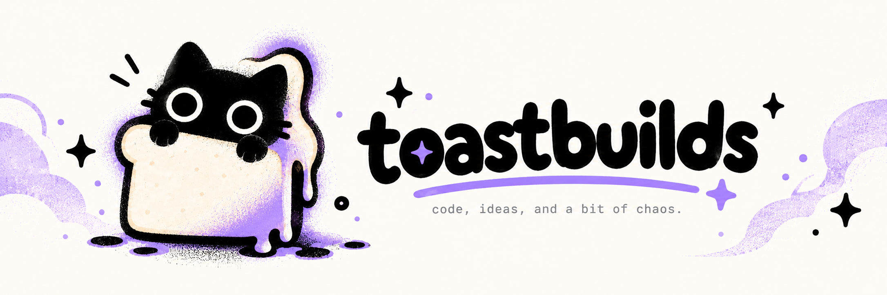
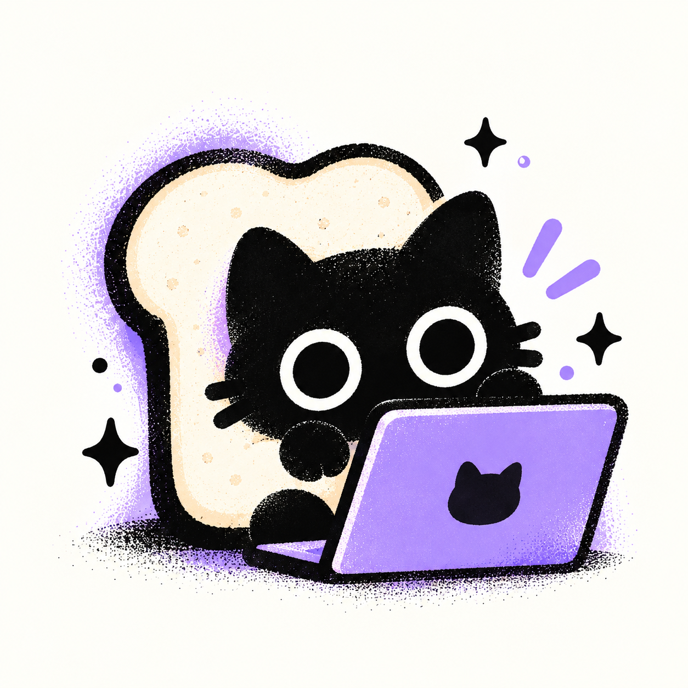
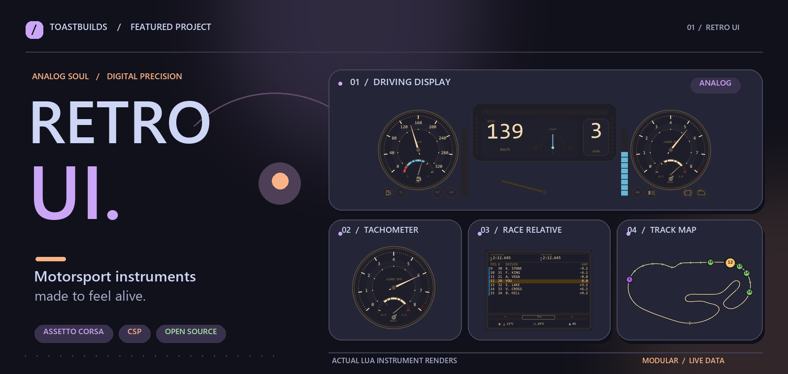

  

  
  
  

<table>
  <tr>
    <td align="center" width="34%">
      
    </td>
    <td valign="middle">
      <h2>hey, i'm Kevin. ☕</h2>
      
Developer &amp; maker of playful interfaces, useful tools, and occasionally chaotic experiments.

      
I work across <b>web, mobile and UI engineering</b>, with a soft spot for tactile design, retro instruments, expressive motion and the little details that make software feel alive.

      
Currently building <a href="https://github.com/toastbuilds/assetto-corsa-retro-engineering-hud"><b>Retro UI</b></a> for Assetto Corsa, while exploring <b>Material 3 Expressive</b> and graphics-driven interfaces.

      
<a href="mailto:lubbok0704@gmail.com">✉️ Say hello</a> &nbsp;·&nbsp; <a href="https://github.com/toastbuilds?tab=repositories">↗ Browse my work</a>

    </td>
  </tr>
</table>

## ✦ In the spotlight: Retro UI

**[Retro UI](https://github.com/toastbuilds/assetto-corsa-retro-engineering-hud)** is an open-source collection of configurable motorsport instruments for **Assetto Corsa + Custom Shaders Patch**. It brings together speed and RPM dials, live timing, tyre information, telemetry, track maps and race awareness in a cohesive retro-inspired interface.

The main app offers independent HUD windows with shared appearance settings, multiple layouts, and the freedom to arrange only the instruments you need.

  
  

  
<b>See the full instrument lineup ↗</b>

   
  

### More from the retro workshop

| Project | What it does |
| :-- | :-- |
| **[Retro Engineering Telemetry](https://github.com/toastbuilds/assetto-corsa-retro-telemetry)** | Independent input and FFB instruments with a five-second live telemetry trace. |
| **[Retro Delta Bar](https://github.com/toastbuilds/assetto-corsa-retro-delta-bar)** | A compact, configurable lap and sector comparison instrument. |
| **[Multiclass Relative](https://github.com/toastbuilds/assetto-corsa-multiclass-relative)** | Lap-aware multiclass traffic and relative gaps for endurance racing. |

## ✳ Other things I've built

| | |
| :-- | :-- |
| **[GPP Volumetrics](https://github.com/toastbuilds/GPP-Volumetrics)** *Kerbal Space Program · visual modding* | Volumetric clouds and atmospheric effects for Galileo's Planet Pack. |
| **[JNSQ Parallax Continued](https://github.com/toastbuilds/JNSQ_ParallaxScattersContinued)** *Kerbal Space Program · terrain* | Terrain-scatter integration for JNSQ with its custom textures. |

## ♡ My toolbox

  
  
  
  
  
  
  
  
  
  

  
  
  

  <a href="mailto:lubbok0704@gmail.com"><b>Have an idea? Let's build something.</b></a>

  

code, ideas, and a bit of chaos. ✦ <a href="https://github.com/catppuccin/catppuccin/blob/main/assets/footers/gray0_ctp_on_line.svg">Footer inspired by Catppuccin</a>.

